# Podogest — Frontend

Frontend de **Podogest**, la aplicación de **Podología Clínica Pasos Saludables** (Quinta Normal, Santiago de Chile). Incluye el sitio público, con reserva de horas en línea, y un panel privado para gestionar la agenda, las citas y las fichas clínicas.

- Sitio: <https://podogest-frontend.vercel.app>
- Backend: Django (repositorio privado). Este proyecto solo consume su API.

## Vista previa

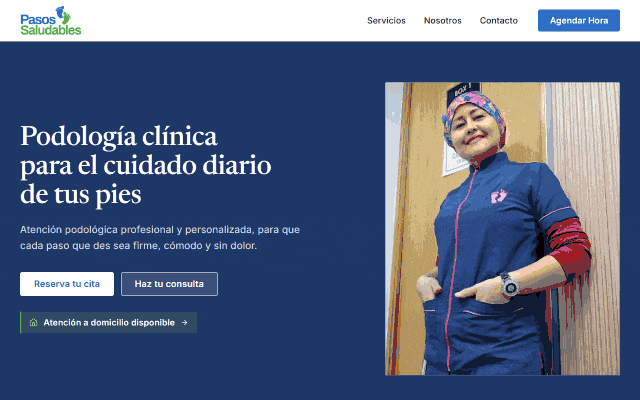

| Pantalla | Escritorio | Celular |
|---|---|---|
| Portada | 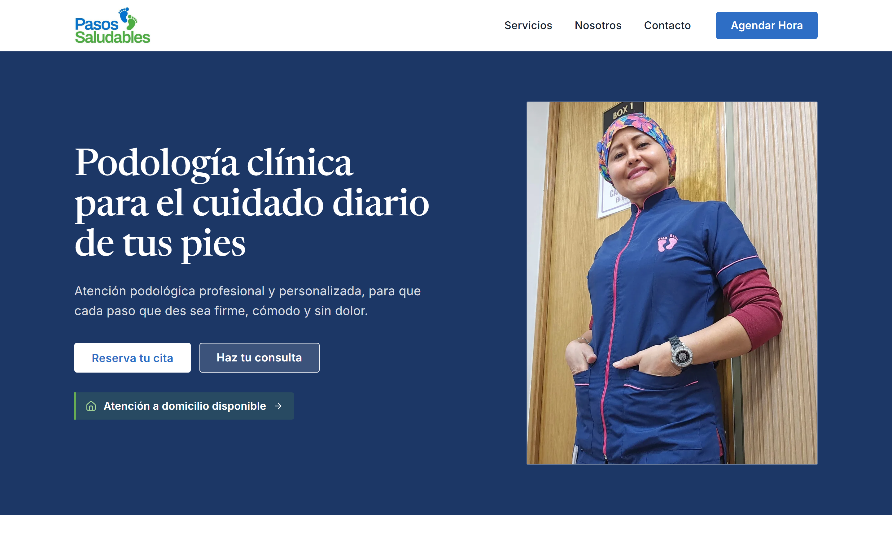 | 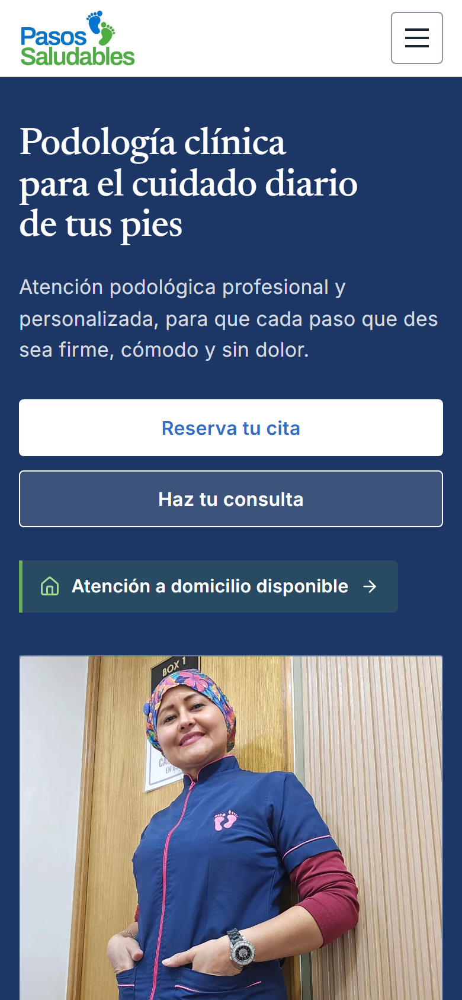 |
| Servicios | 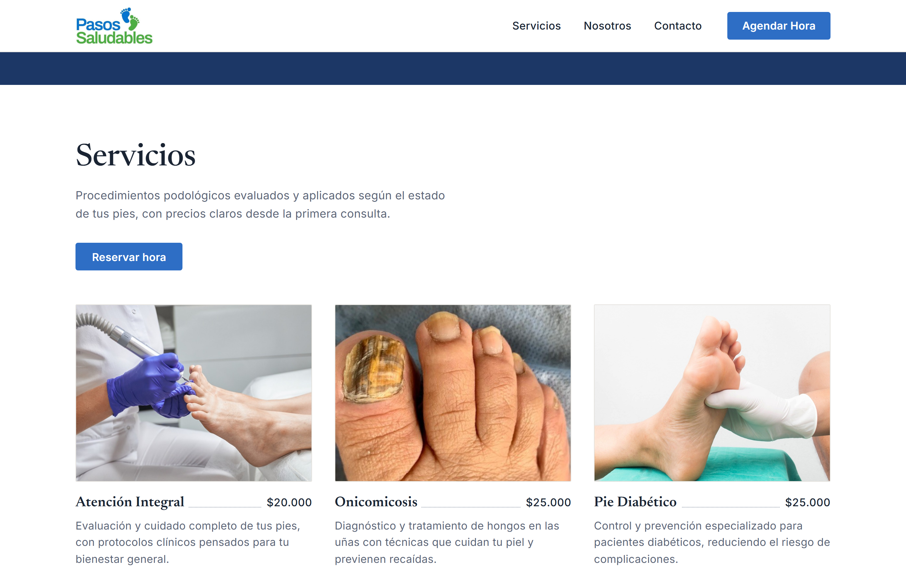 | 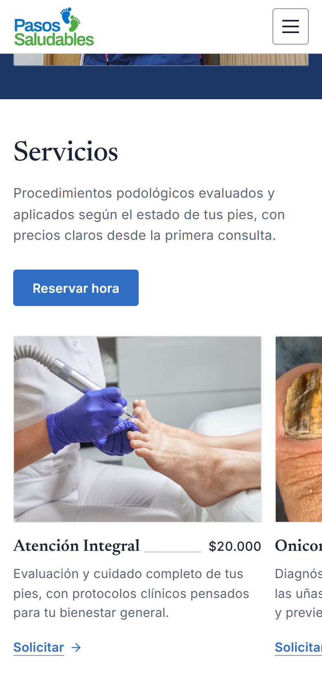 |
| Reserva: selector de horas | 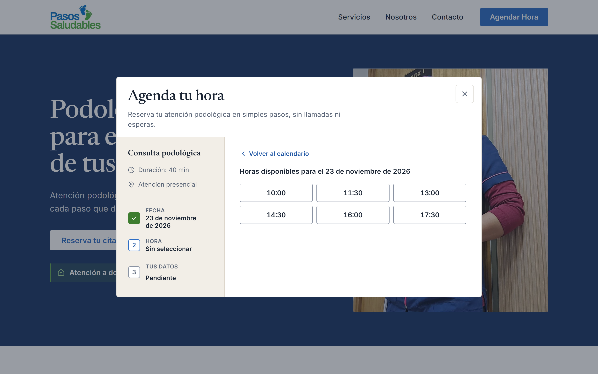 | 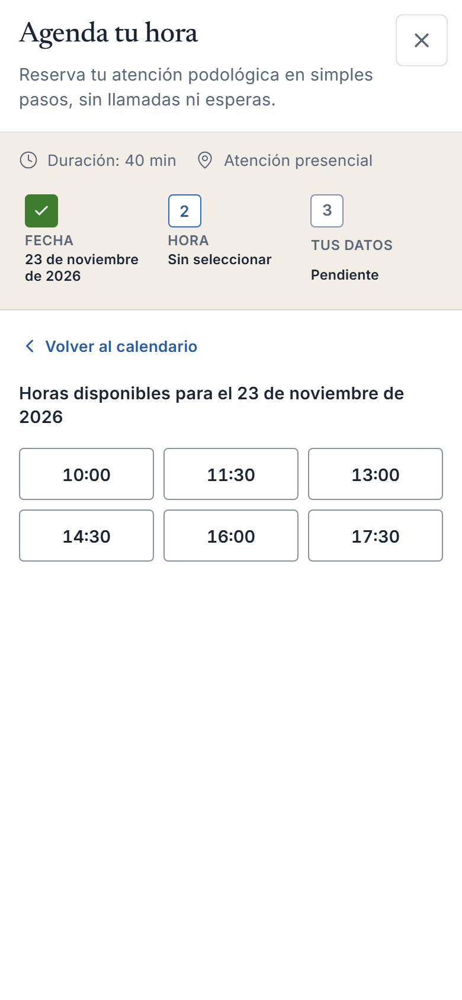 |
| Agenda de hoy | 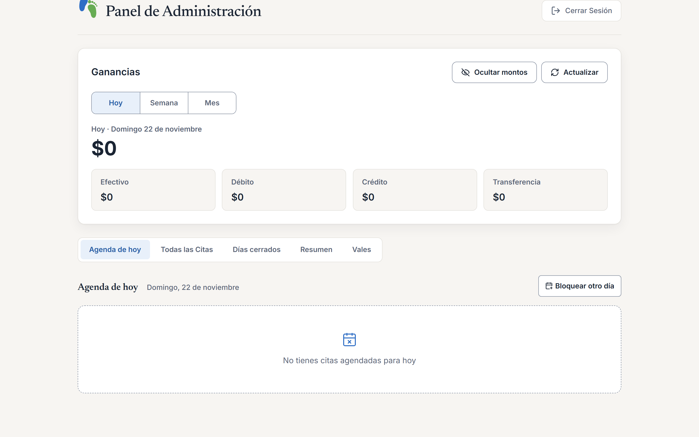 | 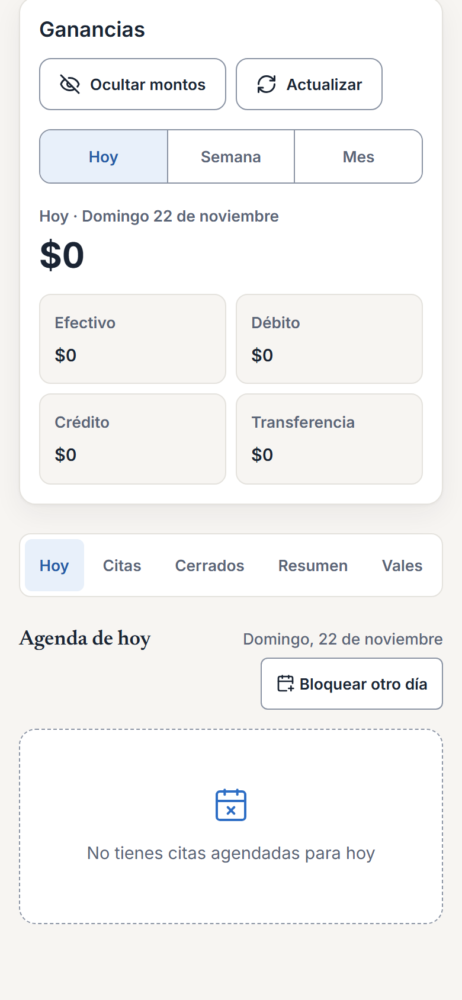 |
| Ganancias | 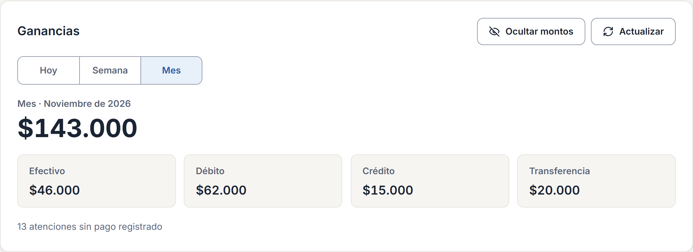 | 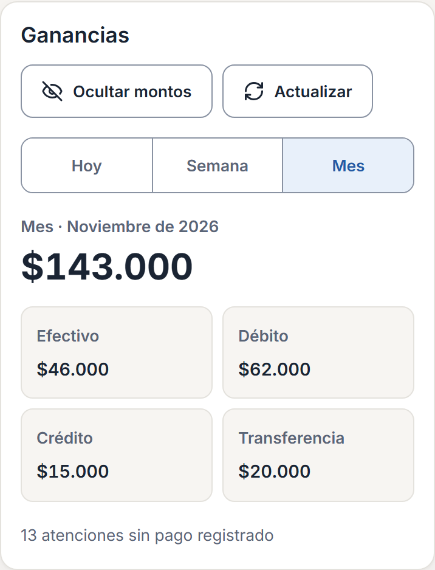 |
| Todas las citas | 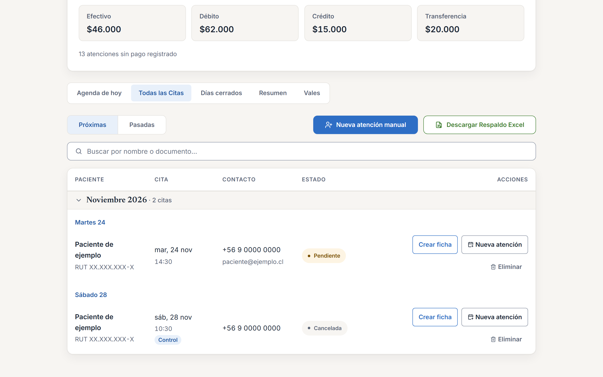 | 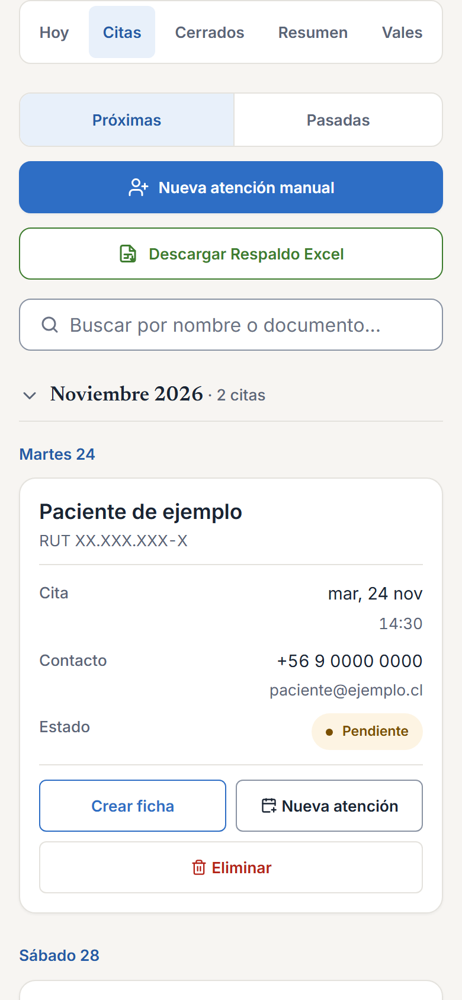 |
| Resumen semanal | 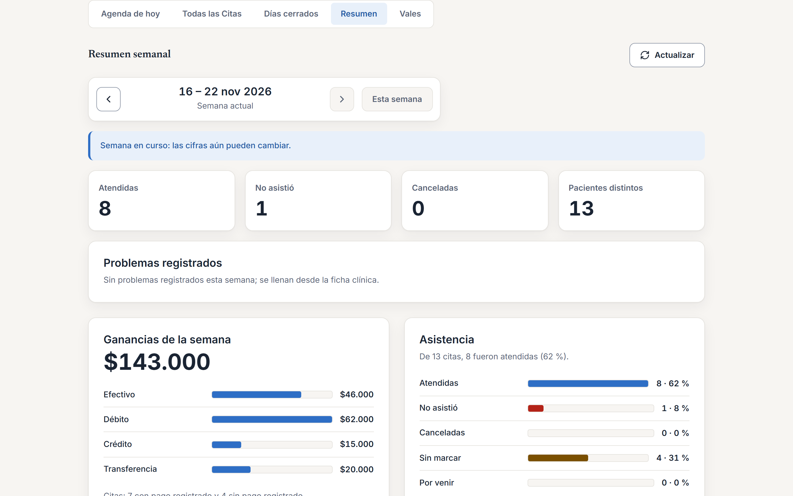 | 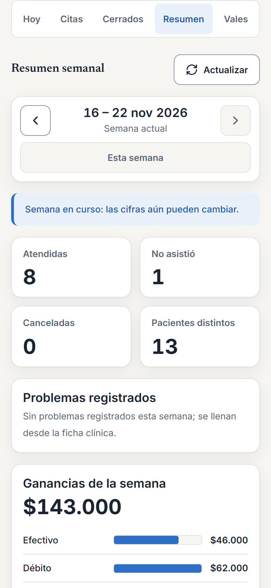 |
| Ficha clínica | 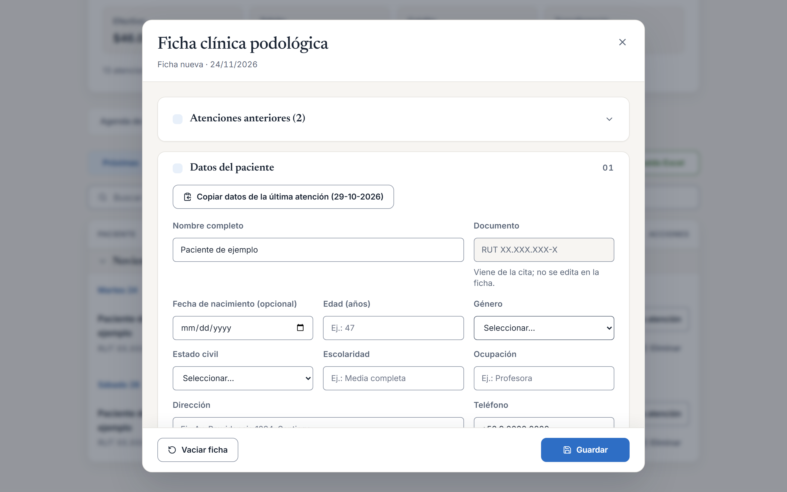 | 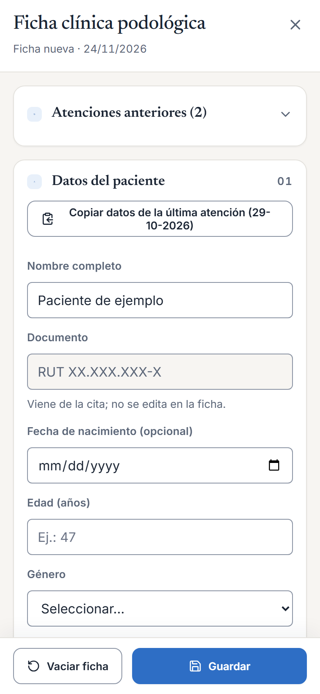 |
| Vales de regalo | 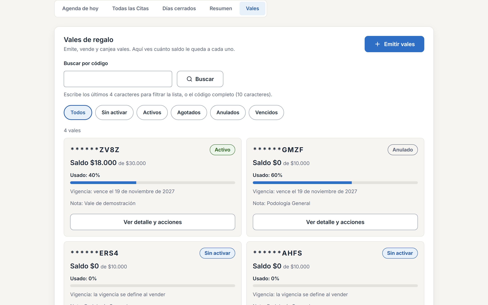 | 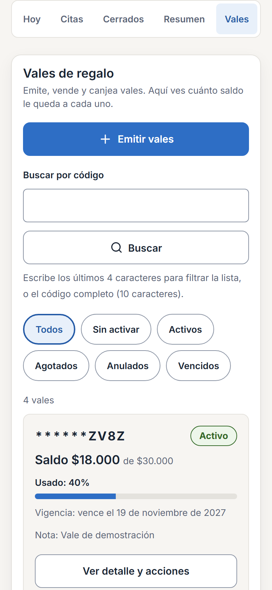 |

Las capturas y el GIF salen de un backend local con datos de demostración; el script reemplaza nombres, documentos, teléfonos y correos por valores ficticios y se detiene si queda alguno a la vista. Se regeneran con `npm run capturas` (ver [Capturas](#capturas)).

## Stack

| Tecnología | Uso |
|---|---|
| React 19 | Interfaz |
| Vite 8 (`@vitejs/plugin-react`) | Servidor de desarrollo y build |
| React Router 7 | Rutas del sitio y del panel |
| Framer Motion | Animaciones de la ficha clínica y de la atención manual |
| Lucide React | Íconos |
| React Icons | Íconos de marca (WhatsApp e Instagram) |
| Fontsource (Inter y Newsreader, variables) | Tipografías propias, sin pedir fuentes a terceros |
| ESLint 10 | Lint |

## Requisitos

- Node `^20.19.0` o `>=22.13.0` (ver `engines` en `package.json`).

## Puesta en marcha

```bash
npm install
cp .env.example .env   # y ajusta VITE_API_URL
npm run dev
```

| Script | Qué hace |
|---|---|
| `npm run dev` | Servidor de desarrollo de Vite |
| `npm run build` | Build de producción en `dist/` |
| `npm run preview` | Sirve el build localmente |
| `npm run lint` | Ejecuta ESLint |
| `npm run capturas` | Regenera las capturas y el GIF de `docs/capturas/` (ver [Capturas](#capturas)) |

### Variables de entorno

| Variable | Descripción |
|---|---|
| `VITE_API_URL` | URL base del backend, sin barra final. Si no se define, `src/config/api.js` usa la URL de producción. |

## Rutas

| Ruta | Contenido |
|---|---|
| `/` | Sitio público |
| `/reservar` | Sitio público con la reserva abierta (enlace directo) |
| `/terminos`, `/privacidad`, `/cookies` | Páginas legales |
| `/login` | Inicio de sesión del panel |
| `/dashboard` | Panel (requiere sesión) |
| `*` | Página 404 |

`/login`, `/dashboard` y la 404 llevan `noindex`.

## Funcionalidades

### Sitio público
- Catálogo de servicios con precios (`src/data/services.js`).
- Reserva en un modal, con selector de horas ocupadas y validación de RUT o pasaporte.
- Pie de página con datos de contacto y un mapa de Google que se carga solo cuando la persona pulsa «Ver mapa».
- Metadatos SEO y datos estructurados `MedicalClinic` en `index.html`, además de `robots.txt` y `sitemap.xml`.

### Panel
- Pestañas: **Agenda de hoy**, **Todas las Citas**, **Días cerrados**, **Resumen** y **Vales**.
- Vista «otro día» dentro de la agenda, para bloquear días. Se abre con `/dashboard?vista=bloqueos`.
- Las vistas también se abren con `?vista=` (`agenda`, `citas`, `cerrados`, `resumen`, `bloqueos`, `vales`).
- **Ficha clínica** con podograma dibujado sobre un mapa de ambos pies y atenciones anteriores del paciente.
- **Atención manual**: registro de una atención sin pasar por la reserva.
- **Ganancias**: tarjeta con totales de hoy, de la semana y del mes, desglosados por medio de pago (efectivo, débito, crédito y transferencia). Los cálculos los entrega el backend (`/api/pagos/resumen/`). El botón «Ocultar montos» los reemplaza por una máscara; la preferencia se guarda en `localStorage` y también afecta a la pestaña Resumen.
- **Resumen semanal** de la semana elegida.
- **Vales de regalo**: emisión, búsqueda por código, venta (activación), canje, ajuste y anulación. En la lista el código siempre va enmascarado (`******` y los últimos 4 caracteres); el código completo solo se ve en el detalle de cada vale y al emitir.
- Descarga de un respaldo en Excel (`.xlsx`).
- La página se recarga sola al volver de segundo plano tras más de 15 minutos, cuando no hay nada a medias.

### App instalable (PWA)
`public/manifest.webmanifest` y los íconos permiten instalar el panel, con atajos a «Bloquear otro día», «Todas las citas», «Resumen semanal» y «Días cerrados». No hay *service worker*, así que no funciona sin conexión.

## Decisiones técnicas

- **Carga diferida**: `AdminLogin`, `Dashboard`, las páginas legales y el panel de vales se cargan con `lazy`, para que la landing no los descargue.
- **Sesión**: `ProtectedRoute` redirige a `/login` si no hay token en `localStorage`, y el login vuelve a la ruta de origen. `src/utils/panelRoutes.js` solo acepta rutas internas del panel como destino.
- **Hora de la clínica**: `src/utils/clinicDate.js` calcula fechas y horas en `America/Santiago`, sin depender de la zona horaria del dispositivo, y `useClinicClock` la refresca cada minuto.
- **Documentos**: `rutValidation.js` valida el RUT (módulo 11) y `documentValidation.js` admite RUT o pasaporte (5 a 20 letras o números, con al menos un número y sin ser un único carácter repetido). Sus mensajes están pensados para coincidir con los del backend, que es quien valida en definitiva.
- **Datos de la clínica**: `src/config/clinic.js` concentra nombre, dirección y enlaces de mapa.
- **Cabeceras de seguridad** (`vercel.json`): `Content-Security-Policy`, `X-Frame-Options: DENY`, `Strict-Transport-Security`, `Referrer-Policy`, `Permissions-Policy` y `X-Content-Type-Options`. `X-Robots-Tag: noindex, nofollow` en `/login` y `/dashboard`.
- **CSP estricta**: la CSP solo permite conectarse al backend de producción y embeber `google.com`. Si el backend cambia de dominio, hay que actualizarla.
- **Descargas**: no se envía `Accept` con un tipo de archivo (provoca 406 en DRF). El tipo se asigna al `Blob` y el nombre se lee de `Content-Disposition`.

## Estructura

```
public/               Imágenes, manifest, íconos, robots.txt y sitemap.xml
src/
  components/         Sitio público y panel (vales/ para la pestaña Vales)
  config/             api.js y clinic.js
  data/               services.js y textos legales
  hooks/              useClinicClock, useReloadOnReturn y otros
  utils/              auth, fechas, validaciones, podograma y resumen semanal
vercel.json           Cabeceras y reescritura a index.html
```

## Capturas

`scripts/capturas.mjs` usa Playwright para generar los PNG (escritorio 1440×900 y celular 390×844, ambos a 2x) y `recorrido.gif` (menor a 3 MB) en `docs/capturas/`.

1. Levanta el backend local en `http://127.0.0.1:8000` con datos de demostración y `npm run dev` en `http://localhost:5173`.
2. Crea `.env.capturas` (ignorado por git) con `CAPTURAS_USUARIO` y `CAPTURAS_CLAVE`, una cuenta de demostración local.
3. Ejecuta `npm run capturas`.

Solo abre `localhost:5173` y `127.0.0.1:8000`: se niega a correr si `VITE_API_URL` no es local y bloquea cualquier otra conexión, de modo que nunca captura producción. Antes de cada captura revisa que no quede un RUT, teléfono, correo o nombre real en pantalla. El GIF solo reemplaza al anterior si cabe en 3 MB, y el script no borra otros archivos de la carpeta.

## Despliegue

Se despliega en Vercel. `vercel.json` reescribe todas las rutas a `index.html` (SPA) y define las cabeceras.
